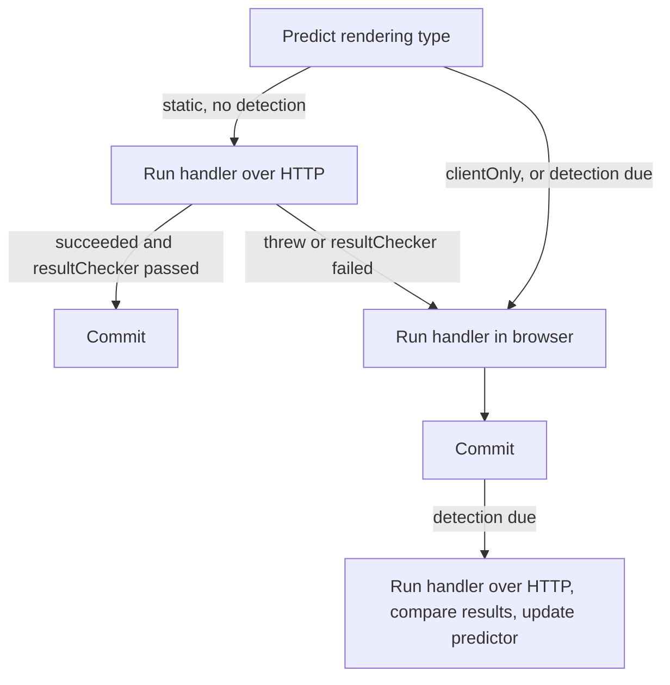

import ApiLink from '@site/src/components/ApiLink';
import CodeBlock from '@theme/CodeBlock';

import BasicSource from '!!raw-loader!./basic.ts';
import ResultCheckerSource from '!!raw-loader!./result-checker.ts';
import PredictorSource from '!!raw-loader!./shared-predictor.ts';

With <ApiLink to="playwright-crawler/class/AdaptivePlaywrightCrawler">`AdaptivePlaywrightCrawler`</ApiLink>, you write your request handler once, and for each request the crawler decides whether to run it over plain HTTP (like <ApiLink to="cheerio-crawler/class/CheerioCrawler">`CheerioCrawler`</ApiLink>) or in a real browser (like <ApiLink to="playwright-crawler/class/PlaywrightCrawler">`PlaywrightCrawler`</ApiLink>). It learns which of the two each page type needs as the crawl goes, and keeps checking its predictions on a sample of requests. On a site that is mostly server-rendered, you get the results of a browser crawl for something close to the cost of an HTTP one.

That also means you can start writing a scraper without first finding out whether the site renders the content you want on the server or in the browser. Write the handler against what you see in the browser's developer tools, and let the crawler work out which pages it can get away with fetching over plain HTTP.

## When to use it

Not having to investigate the rendering up front makes it a reasonable default for most crawls. It pays off the most on sites that mix server-rendered and client-rendered pages, and on crawls across many unrelated sites, where checking each one by hand is not an option.

On a fully static site, it soon runs almost everything over HTTP, apart from a few browser runs while it warms up and an [occasional detection](#tuning-the-prediction). Once you know the target is static, you can switch to `CheerioCrawler` and drop the browser altogether — handy for keeping [Docker images](./docker-images) small, if you deploy that way.

It might be the wrong tool when the handler has to interact with the page — clicking, scrolling, filling forms — on most pages (use `PlaywrightCrawler`), or when the handler has side effects outside of Crawlee storage, because [the handler may run twice](#how-it-works).

Most of the time, you don't need to know how a site renders its pages to use this crawler. When you do — say, to understand why some page type keeps ending up in the browser — the [JavaScript rendering guide](./javascript-rendering) explains the difference.

## Quick start

<CodeBlock className="language-typescript">{BasicSource}</CodeBlock>

The handler does not touch `page` or `$` directly. It goes through [context helpers](#writing-the-request-handler) that work the same in both modes.

## How it works

For every request, a rendering type predictor guesses whether the page is `static` or `clientOnly`, and recommends how likely the crawler should be to verify that guess.



- **Predicted static:** the handler runs over HTTP. If it succeeds and the [`resultChecker`](#defining-a-good-result) accepts the result, it is committed. If the handler throws, or the check fails, the request falls through to the browser. A failed check also counts as a misprediction and teaches the predictor that the page needs a browser.
- **Predicted client-only:** the handler runs in the browser.
- **Detection:** on some requests, the handler runs in the browser *and* over HTTP. The browser result is committed, the two are compared with the [`resultComparator`](#comparing-results-during-detection), and the verdict trains the predictor.

Each attempt runs in its own storage transaction (see [Result storage](./result-storage)). The writes of an attempt that loses — a failed HTTP run, or the HTTP run of a detection — are rolled back, and its log messages are dropped with it. The HTTP run of a detection also sees `useState()` as it was before the browser run, so both runs start from the same state.

:::caution The request handler may run twice

Writes to datasets, key-value stores and the request queue are safe, because a losing attempt's writes are discarded. Anything else — calls to external APIs, files, counters in plain variables — happens once per attempt. Keep the handler free of such side effects, or move them behind storage writes.

:::

This is also why `transactionalStorage: false` is not supported here and throws. A write policy object is accepted, and `requestQueue` defaults to `deferred`, so a discarded attempt's enqueues never reach the queue.

## Writing the request handler

The context (<ApiLink to="playwright-crawler/interface/AdaptivePlaywrightCrawlerContext">`AdaptivePlaywrightCrawlerContext`</ApiLink>) offers helpers with the same signature in both modes:

- `querySelectorOne(selector, timeoutMs?)` and `querySelectorAll(selector, timeoutMs?)` return Cheerio objects with the first match or all matches. When nothing matches, they throw: over HTTP right away, which makes the crawler retry the request in the browser, and in the browser after waiting for the element (5 seconds by default). Use them for elements the page is useless without. For optional ones, call `parseWithCheerio()` and query the result yourself.
- `waitForSelector(selector, timeoutMs?)` does the same check without returning the matches.
- `parseWithCheerio(selector?, timeoutMs?)` gives you a Cheerio handle for the whole page, waiting for `selector` first if you pass one.
- `enqueueLinks()` works the same as in other crawlers, with the same-hostname strategy by default.
- `response` is a Fetch API `Response` in both modes.
- `page` is the Playwright page. Accessing it over HTTP throws, and the request is transparently retried in the browser — so reaching for `page` is how a handler opts into a browser for the pages that need interaction.

Apart from `page` and `response`, all of these helpers exist with the same signatures on the `CheerioCrawler` and `PlaywrightCrawler` contexts too, so a handler that sticks to them moves to either crawler unchanged — for example once you [conclude the target is static](#when-to-use-it).

Routing works as with other crawlers, through <ApiLink to="playwright-crawler/function/createAdaptivePlaywrightRouter">`createAdaptivePlaywrightRouter()`</ApiLink>. Note that `requestHandlerTimeoutSecs` (and per-route timeouts) apply to each attempt (HTTP/browser) separately.

## Defining a good result

:::tip Is this worth it?

Fine-tuning result checks pays off mainly for scrapers that have to work on a wide variety of websites, where the rendering type can't be known in advance. If you are scraping one site, five minutes in your browser's developer tools will usually tell you whether you need a browser at all — and picking `CheerioCrawler` or `PlaywrightCrawler` based on that tends to pay off better than tuning the adaptive crawler.

:::

Out of the box, the crawler trusts any HTTP run that does not throw. To be more precise, pass a `resultChecker(result, { request })`. It receives a read-only <ApiLink to="core/interface/StorageTransactionView">`StorageTransactionView`</ApiLink> of the HTTP run's writes — `datasetItems`, `enqueuedUrls` and `keyValueStoreChanges` — and the `request` that produced them. Returning `false` sends the request to the browser.

<CodeBlock className="language-typescript">{ResultCheckerSource}</CodeBlock>

A good checker looks for whatever a client-rendered page would be missing from its server HTML. A few common shapes:

```ts
// The page produced data at all - a client-rendered listing often yields nothing over HTTP.
resultChecker: ({ datasetItems }) => datasetItems.length > 0,

// Every item has the fields that are typically filled in by a script.
resultChecker: ({ datasetItems }) => datasetItems.every(({ item }) => item.title && item.price),

// A category page should lead somewhere - no enqueued links means the navigation was not rendered.
resultChecker: ({ enqueuedUrls }) => enqueuedUrls.length > 0,

// No placeholder text that the page replaces once its data loads.
resultChecker: ({ datasetItems }) => datasetItems.every(({ item }) => !String(item.price).includes('Loading')),
```

Different page types usually need different checks. Branch on the request label, the same way you would route the request handler:

```ts
resultChecker: ({ datasetItems, enqueuedUrls }, { request }) => {
    switch (request.label) {
        case 'CATEGORY':
            return enqueuedUrls.some(({ label }) => label === 'DETAIL');
        case 'DETAIL':
            return datasetItems.length === 1 && Boolean(datasetItems[0].item.price);
        default:
            return true;
    }
},
```

Keep the checker strict enough to catch an incomplete page, but not so strict that legitimately empty pages (an empty search result, say) are always sent to the browser.

### Errors over HTTP

An error thrown over HTTP sends the request to the browser as well. If a browser would not help — a blocked request, say — pass `shouldPropagateError(error, context)` and return `true` to let the error go through the normal retry mechanism instead.

### Comparing results during detection

During a [detection](#how-it-works), the crawler runs the handler both ways and compares the results. By default, a page counts as static if both runs pushed the same dataset items — or, if you set a `resultChecker`, if both results pass it.

To decide yourself, pass `resultComparator(resultA, resultB, { request })`. Return `true`/`'equal'` for static, `false`/`'different'` for client-only, or `'inconclusive'` to discard the detection. The ready-made <ApiLink to="playwright-crawler/function/fullResultComparator">`fullResultComparator`</ApiLink> also compares enqueued URLs and key-value store changes. It compares URLs exactly, so links that differ only in tracking query parameters make pages look client-rendered.

## Tuning the prediction

`renderingTypeDetectionRatio` (default `0.1`) sets roughly how often a detection runs. The built-in <ApiLink to="playwright-crawler/class/RenderingTypePredictor">`RenderingTypePredictor`</ApiLink> adjusts it:

- With no data yet, it predicts client-only and always runs a detection.
- When it is unsure about a URL, it always runs a detection.
- The ratio is boosted (up to 5×) for request labels with fewer than five results.

The default predictor groups what it has learned by request label, and within a label compares URLs by similarity. **Label your page types** — product pages, listings, articles — and it will need fewer detections to get them right.

What the predictor learns survives migrations and resumed runs, but a fresh run starts from scratch and goes through the warm-up again — unless you [share it across runs](#sharing-detection-results-across-runs).

### Sharing detection results across runs

If you crawl the same site repeatedly, there is no need to relearn its rendering every time. Construct the <ApiLink to="playwright-crawler/class/RenderingTypePredictor">`RenderingTypePredictor`</ApiLink> yourself and point its persistence at a named key-value store, which, unlike the default one, is not purged when a run starts:

<CodeBlock className="language-typescript">{PredictorSource}</CodeBlock>

An injected predictor is borrowed: the crawler never initializes or tears it down. Call `initialize()` before the run to load what earlier runs learned. Declaring the predictor with `await using` tears it down once you are done, which writes out what this run learned. `renderingTypeDetectionRatio` only configures the default predictor, so pass `detectionRatio` to the constructor instead.

:::note Requires Node.js 24

The `await using` syntax needs Node.js 24 or later. On Node.js 22 call <ApiLink to="playwright-crawler/class/RenderingTypePredictor#teardown">`teardown()`</ApiLink> yourself in a `finally` block instead — it is what the disposal hook calls anyway.

:::

A named store is only shared by runs that can open it — on the Apify platform, that means runs under the same account. To go further, see [custom predictors](#custom-predictors).

### Custom predictors

To share detection results more widely — between users, or between crawlers that don't share storage — or to replace the built-in model with rules you already know about the site, implement <ApiLink to="playwright-crawler/interface/IRenderingTypePredictor">`IRenderingTypePredictor`</ApiLink> and pass it as `renderingTypePredictor`. It has two methods:

- `predict(request)` returns the rendering type to use and the probability of running a detection to verify it. The crawler awaits it before every request, so load whatever it needs up front rather than doing I/O per request.
- `storeResult(requests, renderingType)` reports a detection result, or `clientOnly` when the `resultChecker` rejected an HTTP-only result. The crawler does not await it per detection but waits for all pending results before the crawl ends, so an implementation can batch its writes to a remote store.

Rejected results only ever correct a wrong `static` prediction. The only way to find out that a page predicted as client-only is in fact static is a detection, so keep the recommended probability above zero — and raise it for requests you are unsure about.

## Navigation hooks and browser options

`preNavigationHooks` and `postNavigationHooks` run in both modes. As in the request handler, accessing `page` over HTTP throws and makes the crawler retry the request in the browser — and destructuring `{ page }` in the hook's parameters counts as accessing it. Only browser navigations have `gotoOptions`, so check for those first:

```ts
preNavigationHooks: [
    async (context) => {
        if (context.gotoOptions && context.page) {
            await context.page.setViewportSize({ width: 1920, height: 1080 });
        }
    },
],
```

`launchContext`, `headless`, `browserPool` and `remoteBrowser` configure the browser side only. The remaining options, such as proxies, sessions and concurrency, apply to both.

## Monitoring

On top of the usual statistics, the crawler tracks `httpOnlyRequestHandlerRuns`, `browserRequestHandlerRuns` and `renderingTypeMispredictions` in `crawler.statistics.state`. A high misprediction count means the HTTP runs are often rejected — a hint to add labels or a better `resultChecker`. To track fields of your own next to these, see [Custom statistics](./custom-statistics#crawlers-that-track-fields-of-their-own).

Debug logs show the predicted and detected rendering type for each URL.

## Shutting down

`teardown()` waits for detections that are already under way to settle before stopping, so their results reach the predictor. If you run the crawler with `keepAlive` and stop it yourself, <ApiLink to="playwright-crawler/class/AdaptivePlaywrightCrawler#drainRenderingDetections">`drainRenderingDetections()`</ApiLink> and `inFlightRenderingTypeDetectionCount` let you do the same on your own terms.
