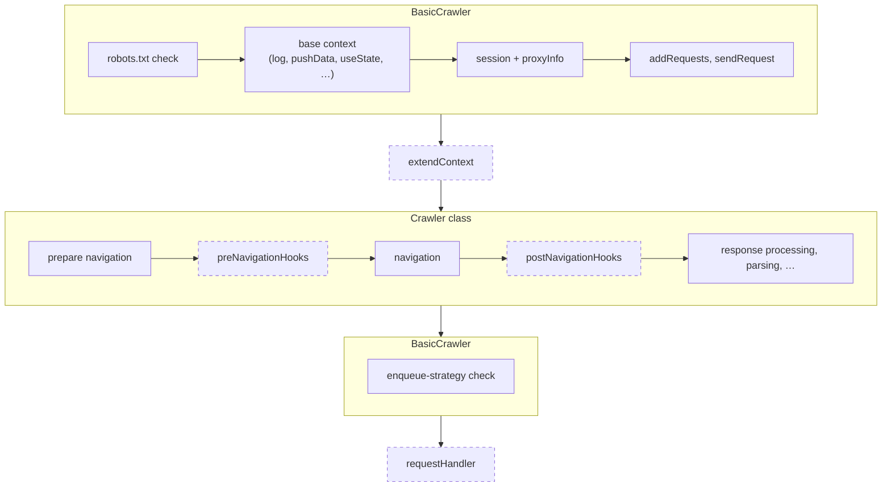

import ApiLink from '@site/src/components/ApiLink';

Every request a crawler picks up goes through the same sequence of steps before the `requestHandler` sees it, and through another fixed sequence afterwards, whether the handler succeeded or not. This guide covers where the navigation hooks run, what the timeouts cover, how retries and the error handlers work, how to skip a request on purpose, and when cleanup happens.

## The steps

Every crawler runs each request through a chain of middlewares, the <ApiLink to="basic-crawler/class/ContextPipeline">`ContextPipeline`</ApiLink>. Each step adds members to the crawling context the request handler eventually receives. `BasicCrawler` owns the first steps and the last one, the crawler class (`CheerioCrawler`, `PlaywrightCrawler`, …) contributes the middle, and the `extendContext` option sits between them. Dashed nodes are your code:

For `CheerioCrawler` the middle part makes the HTTP request and parses the body into `$`. For `PlaywrightCrawler` it opens a page and navigates it. The enqueue-strategy check skips requests that no longer match `strategy` after a redirect.

To add your own members to the context, see [Customizing the crawling context](./crawling-context).

## Navigation hooks

`preNavigationHooks` run after `extendContext` and before the navigation, `postNavigationHooks` right after it. They receive the same context the request handler will, minus whatever navigation has not produced yet. A pre-navigation hook on a browser crawler has `page` but no `response`. On an HTTP crawler it has neither `response` nor `body`.

A hook can return a `Partial` of the crawling context, and the crawler copies the returned members onto it, replacing the existing ones. This is how `handleCloudflareChallengeHook()` swaps the challenge response for the real one. See [Customizing the crawling context](./crawling-context#returning-from-a-navigation-hook) for an example.

## Timeouts

Three timeouts apply:

| Option | Covers | Default |
| --- | --- | --- |
| `navigationTimeoutSecs` | the `preNavigationHooks`, the navigation, and the `postNavigationHooks` together | 30 (HTTP), 60 (browser) |
| `requestHandlerTimeoutSecs` | the `requestHandler` only | 60 |
| `CRAWLEE_INTERNAL_TIMEOUT` (env, ms) | the whole request, including the phases that have no timeout of their own (`extendContext`, the robots.txt check, response processing) | twice the request handler timeout, at least 5 minutes |

`navigationTimeoutSecs` is a single budget shared by the whole navigation phase, so a slow hook eats into the window the navigation itself uses. A single route can override `requestHandlerTimeoutSecs` through its `router.addHandler()` options, and `context.extendTimeout(secs)` extends the current window from inside a hook or the handler.

## Failures and retries

A request handler, navigation hook, or any other step that throws fails the current attempt. The remaining steps and the request handler do not run. What happens next depends on whether the request can be retried.

- The crawler retries while `request.retryCount` is below `maxRequestRetries` (or the request's own `maxRetries`), unless `request.noRetry` is set or the error is a <ApiLink to="core/class/NonRetryableError">`NonRetryableError`</ApiLink>. Throwing a <ApiLink to="basic-crawler/class/RetryRequestError">`RetryRequestError`</ApiLink> forces a retry regardless of the count.
- Before each retry, the crawler calls `errorHandler` with the context and the error, then puts the request back in the queue.
- When no retry is left, it calls `failedRequestHandler` instead, marks the request as handled and counts it as failed.
- A <ApiLink to="core/class/CriticalError">`CriticalError`</ApiLink> stops the whole crawler.

Both handlers may run after a failure that happened before the context was fully built, so everything the crawler class and `extendContext` add is typed as optional there. Check for `page` or `$` before using it. `request`, `log` and the storage helpers are always present. `session` is typed as present but is missing when fetching the session itself failed.

A failed attempt also marks the session as bad, and a <ApiLink to="core/class/SessionError">`SessionError`</ApiLink> retires it. See [Session management](./session-management).

### Skipping a request without failing it

Some requests should end without counting as a failure. Calling <ApiLink to="basic-crawler/interface/RestrictedCrawlingContext#skipRequest">`context.skipRequest(message?)`</ApiLink> ends the request as skipped. The crawler marks it as handled, does not retry it, does not call `failedRequestHandler` and logs no error. <ApiLink to="basic-crawler/interface/BasicCrawlerOptions#onSkippedRequest">`onSkippedRequest`</ApiLink> fires with the `'manual'` reason and the message you passed. It works from `extendContext`, a navigation hook, the request handler and `errorHandler`. In `failedRequestHandler` it has no effect.

Storage writes made for the request before the skip are rolled back, the same as on failure.

See the [Skipping requests](../examples/skip-request) example.

## Storage writes

Every request runs inside a storage transaction. Writes made through the context helpers or the storage classes are recorded while the request is being handled, applied all together when the request handler succeeds, and dropped when it fails or is skipped. A retry therefore never double-writes. See [Transactional storage](./result-storage#transactional-storage) for the details and the exceptions.

## Cleanup

Once the request handler has returned or thrown and any error handler has run, the crawler tears down what the steps set up, such as a browser page or an HTTP connection, and anything you registered yourself.

You register teardown from `extendContext`, a navigation hook or the request handler with <ApiLink to="basic-crawler/interface/CrawlingContext#registerDeferredCleanup">`context.registerDeferredCleanup()`</ApiLink>. The callback runs once the request is done, whether it succeeded or failed. It receives no argument, and if it throws, the crawler logs the error at debug level and carries on.

When they run:

- Cleanups run after `errorHandler` and `failedRequestHandler`, so an error handler still sees the page or connection.
- They run after the request's storage writes have been committed or rolled back. A storage write made in a cleanup applies immediately and is never rolled back.
- Cleanups run in reverse registration order.

Crawler subclasses register cleanup from their pipeline steps with the `onCleanup` callback instead, which also receives the failure. See [The pipeline API](./crawling-context#the-pipeline-api).
